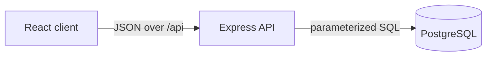

# Momentum

[](https://github.com/boss4679/Momentum/actions/workflows/ci.yml)

A full-stack productivity app that combines workout tracking, a weekly calendar and
calorie logging, with a daily dashboard built on SQL aggregation.


> _Screenshot placeholder: add `docs/screenshot.png`._

## Features

- **Workouts:** log sets (reps, weight or duration), view history and personal bests.
- **Calendar:** week view with create, edit and delete; overlapping events are detected.
- **Calorie log:** entries per meal, tracked against a daily goal.
- **Dashboard:** today's summary plus 30-day trends (7-day rolling average, weekly volume).

## Tech stack

- **Frontend:** React, React Router, Recharts, Vite
- **Backend:** Node.js, Express, Zod validation, JWT authentication
- **Database:** PostgreSQL 16 with raw parameterized SQL (`pg`) and node-pg-migrate
- **Testing and tooling:** Jest, Supertest, Vitest, React Testing Library, ESLint, Prettier,
  Docker Compose, GitHub Actions

## Architecture



Each request passes through JWT authentication and Zod validation before reaching a
controller, which calls SQL query functions scoped to the logged-in user. Errors are
returned in one consistent shape: `{ "error": { "code", "message", "details" } }`.

## Getting started

**With Docker:**

```bash
docker compose up --build -d
docker compose exec api npm run seed
```

The app runs at http://localhost:5173 (demo login: `demo@momentum.dev` / `password123`),
and the API docs at http://localhost:4000/api/docs.

**Without Docker:** requires Node 20.19+ and PostgreSQL 16. Create the `momentum` and
`momentum_test` databases, copy `server/.env.example` to `server/.env`, then:

```bash
cd server && npm install && npm run migrate -- up && npm run seed && npm run dev
cd client && npm install && npm run dev    # in a second terminal
```

## Tests

```bash
cd server && npm test     # API tests against a separate Postgres test database
cd client && npm test     # component and unit tests
```

CI runs linting, both test suites and a production build on every push.

## API

Interactive documentation is available at `/api/docs` (OpenAPI 3.1). All endpoints except
health, register and login require a `Bearer` token.

| Resource        | Endpoints                                                   |
| --------------- | ----------------------------------------------------------- |
| Auth            | `POST /auth/register`, `POST /auth/login`, `GET /auth/me`   |
| Summary         | `GET /summary/daily`, `GET /summary/trends`                 |
| Workouts        | CRUD on `/workouts`, `GET /workouts/personal-bests`         |
| Exercises       | CRUD on `/exercises`                                        |
| Calendar events | CRUD on `/events` (`?allowOverlap=true` to save a conflict) |
| Food entries    | CRUD on `/food-entries`                                     |
| Calorie goals   | CRUD on `/goals`, `GET /goals/current`                      |

Example:

```bash
TOKEN=$(curl -s -X POST http://localhost:4000/api/auth/login \
  -H 'Content-Type: application/json' \
  -d '{"email":"demo@momentum.dev","password":"password123"}' \
  | node -pe 'JSON.parse(require("fs").readFileSync(0)).token')

curl -s http://localhost:4000/api/summary/daily -H "Authorization: Bearer $TOKEN"
```

## Design decisions

**Raw SQL instead of an ORM.** The summary endpoints rely on window functions, generated
date series and `DISTINCT ON`, which are clearer as SQL than through an ORM. All values are
passed as parameters (`$1`, `$2`), never concatenated into query strings.

**404 instead of 403 for other users' data.** Every query filters by `user_id`, so a request
for another user's record finds nothing and returns 404. A 403 would confirm that the
record exists.

**Event overlap detection.** Two events overlap when
`existing.starts_at < new.ends_at AND existing.ends_at > new.starts_at`. The check and the
insert run in one transaction under a per-user advisory lock, so two simultaneous requests
can't both pass the check. A conflict returns 409 with the clashing events, and the client
can resend with `?allowOverlap=true` to save anyway.

## Results

- 359 automated tests (324 server, 35 client), with 99.6% line coverage on the server.
- Composite `(user_id, date)` indexes cut the 30-day calorie query from 7.75 ms to 0.17 ms
  on a dataset of 500+ users. Details in [docs/indexes.md](docs/indexes.md).
- Database design and ER diagram: [docs/schema.md](docs/schema.md).

## License

MIT, see [LICENSE](LICENSE).
