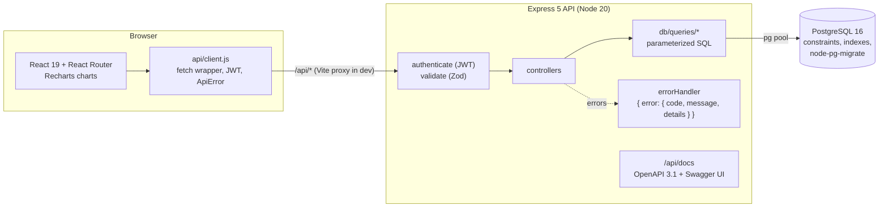

# Momentum

[](https://github.com/boss4679/Momentum/actions/workflows/ci.yml)

A full-stack productivity app: workout tracking, a weekly calendar and calorie logging,
with a daily dashboard built from one aggregation endpoint.

The interesting part is the back end: a normalized PostgreSQL schema with constraints
doing real work, hand-written parameterized SQL (window functions, gaps-and-islands,
`DISTINCT ON`, advisory locks), indexes justified with `EXPLAIN ANALYZE`, and over 300
tests that run against a real database.


> _Screenshot placeholder: add `docs/screenshot.png` (the dashboard with the demo data)._

## What it does

- **Workouts:** log a workout with any number of sets (reps, weight or duration), browse
  history, and see personal bests per exercise.
- **Calendar:** a week view with create, edit and delete. Overlapping events are refused
  with a clear 409, unless you choose to save anyway.
- **Calorie log:** entries per meal (breakfast, lunch, dinner, snack) against a daily
  goal. Goals have start dates, so changing your goal doesn't rewrite the past.
- **Dashboard:** today's workouts, upcoming events, calories against the goal, workout
  streak, plus 30-day trends (7-day rolling average, weekly training volume). It's all
  computed in SQL and served by `GET /api/summary/daily` and `GET /api/summary/trends`.
- **Accounts:** register and log in with JWT. Each user's "today" follows their own timezone.

## Architecture



Request flow: the route runs `authenticate` (verifies the JWT and sets `req.user`) and
then `validate(schema)` (Zod checks params, query and body, and puts parsed values on
`req.validated`). The controller calls query functions. Each takes the pool or a
transaction client as its first argument and filters every query by `user_id`. Any
thrown error, including Postgres constraint violations, is turned into one JSON error
shape by `errorHandler`.

```
Momentum/
├── server/                  Express API (CommonJS)
│   ├── migrations/          SQL migrations (schema, indexes)
│   ├── scripts/             migrate, seed, explain
│   ├── src/
│   │   ├── routes/          URL -> middleware -> controller
│   │   ├── controllers/     HTTP in, HTTP out
│   │   ├── db/queries/      all SQL lives here
│   │   ├── schemas/         Zod request schemas (also feed the OpenAPI docs)
│   │   ├── middleware/      authenticate, validate, errorHandler, ...
│   │   └── docs/            OpenAPI document
│   └── tests/               Jest + Supertest against momentum_test
├── client/                  React + Vite
│   └── src/{api,auth,hooks,components,features,pages,utils}
├── docs/                    schema.md (ER diagram), indexes.md (EXPLAIN results)
├── .github/workflows/ci.yml lint + server tests (Postgres service) + client tests/build
└── docker-compose.yml       db + api + client
```

More detail: [docs/schema.md](docs/schema.md) (ER diagram and table design),
[docs/indexes.md](docs/indexes.md) (query plans before and after indexing),
[LEARNING_NOTES.md](LEARNING_NOTES.md) (concepts and interview questions per milestone).

## Running it

### With Docker (recommended)

You need Docker with Compose.

```bash
docker compose up --build -d              # Postgres, API on :4000, client on :5173
docker compose exec api npm run seed      # demo data: demo@momentum.dev / password123
```

- App: http://localhost:5173 (log in as `demo@momentum.dev` / `password123`)
- API docs: http://localhost:4000/api/docs
- Health: http://localhost:4000/api/health

The API container applies migrations on start. Source folders are mounted, so edits
reload automatically. After changing dependencies, rebuild with fresh `node_modules`:
`docker compose up -d --build -V api` (or `client`).

### Without Docker

You need Node 20.19+ and PostgreSQL 16.

```bash
# 1. Databases (app + tests)
createuser -P momentum                 # password: momentum
createdb -O momentum momentum
createdb -O momentum momentum_test

# 2. API
cd server
cp .env.example .env                   # edit DATABASE_URL etc. if yours differ
npm install
npm run migrate -- up
npm run seed
npm run dev                            # http://localhost:4000

# 3. Client (second terminal)
cd client
npm install
npm run dev                            # http://localhost:5173, proxies /api to :4000
```

## Tests

| suite                     | command                                       | what it covers                                                                                  |
| ------------------------- | --------------------------------------------- | ----------------------------------------------------------------------------------------------- |
| Server (Jest + Supertest) | `cd server && npm test`                       | every endpoint, validation, auth, ownership, SQL aggregates, constraints, locking, the API docs |
| Server with coverage      | `cd server && npm run test:coverage`          | same, plus a report in `server/coverage/`                                                       |
| Client (Vitest + RTL)     | `cd client && npm test`                       | API client, auth flow, forms and error display, calendar layout, food log states                |
| Lint and format           | `npm run lint && npm run format:check` (root) | ESLint (including React hooks rules) and Prettier                                               |
| Inside Docker             | `docker compose exec api npm test`            | server tests on the container's Node 20                                                         |

Server tests use a separate `momentum_test` database: migrations run once before the
suite, and each test file starts from `TRUNCATE ... RESTART IDENTITY CASCADE`. Nothing is
mocked at the database level, because constraints, transactions and SQL are the things
being tested. Client tests run in `America/New_York` so date code that assumes UTC fails.

CI ([.github/workflows/ci.yml](.github/workflows/ci.yml)) runs lint, server tests
against a Postgres 16 service container, and client tests plus a production build on
every push and pull request.

## API

All endpoints are under `/api`, and all except health, register and login need
`Authorization: Bearer <token>`. Full request and response schemas, with "try it out",
are at **`/api/docs`**; the raw document is at `/api/docs/openapi.json`.

| method           | path                        | description                                                         |
| ---------------- | --------------------------- | ------------------------------------------------------------------- |
| GET              | `/health`                   | API and database status                                             |
| POST             | `/auth/register`            | Create an account (returns a token)                                 |
| POST             | `/auth/login`               | Log in (returns a token)                                            |
| GET              | `/auth/me`                  | The logged-in user                                                  |
| GET              | `/summary/daily?date=`      | One day's dashboard: workouts, events, calories, streak             |
| GET              | `/summary/trends?from=&to=` | Daily calories with 7-day rolling average, weekly volume, streak    |
| GET, POST        | `/workouts`                 | List (paged, `from`/`to`) / create with sets                        |
| GET              | `/workouts/personal-bests`  | Best weight, reps and duration per exercise                         |
| GET, PUT, DELETE | `/workouts/{id}`            | One workout (PUT replaces it, sets included)                        |
| GET, POST        | `/exercises`                | List (`category` filter) / create                                   |
| GET, PUT, DELETE | `/exercises/{id}`           | One exercise (DELETE is 409 while sets use it)                      |
| GET, POST        | `/events`                   | List events overlapping `from`/`to` / create (`?allowOverlap=true`) |
| GET, PUT, DELETE | `/events/{id}`              | One event                                                           |
| GET, POST        | `/food-entries`             | List (`from`/`to`/`meal`) / create                                  |
| GET, PUT, DELETE | `/food-entries/{id}`        | One entry                                                           |
| GET, POST        | `/goals`                    | List / create a calorie goal from a date                            |
| GET              | `/goals/current?date=`      | The goal in force on a date (404 if none)                           |
| GET, PUT, DELETE | `/goals/{id}`               | One goal                                                            |

Lists return `{ "data": [...], "pagination": { "limit", "offset", "total" } }`.
Every error returns `{ "error": { "code", "message", "details": [{ "field", "message" }] } }`.

| status | when                                                                      |
| ------ | ------------------------------------------------------------------------- |
| 400    | bad path or query parameter, malformed JSON                               |
| 401    | missing, invalid or expired token; wrong email or password                |
| 404    | no such resource, **or it belongs to another user**                       |
| 409    | duplicate (email, exercise name, goal date), in-use delete, event overlap |
| 422    | request body fails validation (`details` names each field)                |

### curl examples

```bash
API=http://localhost:4000/api

# Log in and keep the token
TOKEN=$(curl -s -X POST $API/auth/login -H 'Content-Type: application/json' \
  -d '{"email":"demo@momentum.dev","password":"password123"}' \
  | node -pe 'JSON.parse(require("fs").readFileSync(0)).token')

# Today's dashboard
curl -s $API/summary/daily -H "Authorization: Bearer $TOKEN"

# Log a workout: two sets of bench press (look up the exercise id first)
BENCH=$(curl -s "$API/exercises?limit=100" -H "Authorization: Bearer $TOKEN" \
  | node -pe 'JSON.parse(require("fs").readFileSync(0)).data.find((e) => e.name === "Bench Press").id')
curl -s -X POST $API/workouts -H "Authorization: Bearer $TOKEN" -H 'Content-Type: application/json' \
  -d '{"performedOn":"2026-03-02","sets":[
        {"exerciseId":'$BENCH',"setNumber":1,"reps":8,"weightKg":60},
        {"exerciseId":'$BENCH',"setNumber":2,"reps":6,"weightKg":65}]}'

# Create an event; a clash returns 409 EVENT_OVERLAP listing the other event(s)
curl -s -X POST $API/events -H "Authorization: Bearer $TOKEN" -H 'Content-Type: application/json' \
  -d '{"title":"Dentist","startsAt":"2026-03-02T17:00:00Z","endsAt":"2026-03-02T18:00:00Z","category":"personal"}'

# ...and save it anyway
curl -s -X POST "$API/events?allowOverlap=true" -H "Authorization: Bearer $TOKEN" \
  -H 'Content-Type: application/json' \
  -d '{"title":"Dentist","startsAt":"2026-03-02T17:00:00Z","endsAt":"2026-03-02T18:00:00Z"}'

# Log lunch, then see 30 days of trends
curl -s -X POST $API/food-entries -H "Authorization: Bearer $TOKEN" -H 'Content-Type: application/json' \
  -d '{"eatenOn":"2026-03-02","meal":"lunch","name":"Chicken salad","calories":550,"proteinG":40}'
curl -s "$API/summary/trends?from=2026-02-01&to=2026-03-02" -H "Authorization: Bearer $TOKEN"

# A validation error names the field
curl -s -X POST $API/food-entries -H "Authorization: Bearer $TOKEN" -H 'Content-Type: application/json' \
  -d '{"eatenOn":"2026-03-02","meal":"brunch","name":"Eggs"}'
# {"error":{"code":"VALIDATION_ERROR","message":"Validation failed","details":[
#   {"field":"meal","message":"Must be one of: breakfast, lunch, dinner, snack"},
#   {"field":"calories","message":"Calories are required"}]}}
```

## Design decisions

### Raw SQL with `pg` instead of an ORM

Every query is a hand-written, parameterized SQL string in `server/src/db/queries/`.

- **The hard queries are SQL anyway.** The rolling average (a window function over a
  `generate_series` calendar), the workout streak (gaps-and-islands with `row_number()`),
  personal bests (`DISTINCT ON`) and nested workout sets (CTE + `json_agg`) are awkward or
  impossible to express through an ORM. Writing every query the same way keeps one style.
- **What runs is what you read.** `scripts/explain.js` imports the exact SQL strings the
  API uses and runs `EXPLAIN ANALYZE` on them, so the index measurements in
  [docs/indexes.md](docs/indexes.md) are for the real queries, not an approximation.
- **No N+1 by construction.** A workout list with its sets is one query, not one per
  workout.
- **Safety comes from parameters, not the library.** Values always go in as `$1, $2, ...`
  and are never concatenated into the SQL text. Optional filters are written
  `($2::date IS NULL OR eaten_on >= $2)` rather than built dynamically.
- **The cost:** column lists are repeated, and response objects are shaped by hand
  (`created_at AS "createdAt"`). Migrations are also plain SQL (node-pg-migrate), so the
  schema is exactly what Postgres sees.

### 404, not 403, for other users' data

Every query includes `WHERE ... AND user_id = $n`. If you ask for workout 42 and it
belongs to someone else, the query finds nothing and the API answers **404 Not Found**,
the same as if it didn't exist. A 403 would confirm that id 42 exists, letting anyone
discover other users' records by counting through ids. Answering 404 reveals nothing,
and it falls out of the query with no separate permission check.
`tests/api/ownership.test.js` checks this for every resource and every verb.
The same idea applies to login: a wrong email and a wrong password give the same 401, and
bcrypt runs against a dummy hash when the email doesn't exist, so response timing doesn't
reveal which emails are registered.

### Event overlap detection

Two events overlap when `existing.starts_at < new.ends_at AND existing.ends_at > new.starts_at`.
Events that merely touch (one ends at 10:00 and the next starts at 10:00) don't count.

- **Race condition:** "check for overlaps, then insert" is two statements. Two
  simultaneous requests could both pass the check and both insert. The create and update
  run in a transaction that first takes `pg_advisory_xact_lock(1, user_id)`, so a user's
  calendar writes run one at a time. The lock is released at commit, and other users are
  never blocked. `tests/db/eventLock.test.js` uses two real connections to prove the
  second writer waits, and it fails if the lock is removed.
- **Why not an exclusion constraint?** `EXCLUDE USING gist (user_id WITH =, tstzrange(starts_at, ends_at) WITH &&)`
  would enforce no-overlap in the schema itself. But overlapping events are allowed
  here when the user confirms (`?allowOverlap=true`), so it's a soft rule, checked
  in code.
- **Response:** 409 with code `EVENT_OVERLAP` and the clashing events in `details`. The
  UI shows "This time clashes with another event", lists each clash with its time, and
  offers a **Save anyway** button that resends the same body with `allowOverlap=true`.
- **Display:** the hand-built week grid splits events that cross midnight into one piece
  per day, and places overlapping events side by side using a greedy lane assignment
  (`client/src/utils/calendarLayout.js`).

### Other choices worth knowing

- **Database constraints are the final rule-keepers.** CHECK constraints (calories ≥ 0,
  `ends_at > starts_at`, a set has reps or a duration), unique indexes (one email,
  exercise names unique per user ignoring case) and foreign keys hold even if
  application code has a bug. Postgres error codes are mapped to clean HTTP errors
  (23505 → 409, 23514 → 422).
- **Dates vs instants.** Workouts and meals happen on a calendar day (`date`); events
  happen at a moment (`timestamptz`). The user's timezone decides what "today" is.
- **Docs generated from the validators.** The OpenAPI request schemas are produced from
  the same Zod schemas the `validate` middleware uses, and a test fails if a route is
  missing from the docs or a response doesn't match its documented shape.

## Results

Measured on 2026-11-16 (Postgres 16 in Docker on WSL2). Commands to reproduce each number
are in the right-hand column.

| metric                          | result                                                                                                                       | reproduce                                  |
| ------------------------------- | ---------------------------------------------------------------------------------------------------------------------------- | ------------------------------------------ |
| API operations                  | **33** (all documented in OpenAPI; a test checks the docs match the routes)                                                  | `/api/docs`                                |
| Automated tests                 | **359**: 324 server + 35 client                                                                                              | `npm test` in `server/` and `client/`      |
| Server coverage                 | **99.6%** lines, 94.6% branches, 99.4% functions                                                                             | `cd server && npm run test:coverage`       |
| Tests checked against real bugs | Bugs introduced on purpose in each milestone (SQL windows, locking, ownership, docs drift, UI races) to confirm a test fails | see [LEARNING_NOTES.md](LEARNING_NOTES.md) |
| 30-day calorie trend query      | 7.75 ms → **0.17 ms** with `(user_id, eaten_on)` index (~45×)                                                                | [docs/indexes.md](docs/indexes.md)         |
| One week of events query        | 3.91 ms → **0.04 ms** (~90×)                                                                                                 | [docs/indexes.md](docs/indexes.md)         |
| Workout streak query            | 0.83 ms → **0.09 ms** (~10×)                                                                                                 | [docs/indexes.md](docs/indexes.md)         |
| Dataset for the query timings   | 501 users, ~260k food entries, ~245k workout sets, ~145k events                                                              | `npm run seed -- --extra-users=500`        |

## License

MIT, see [LICENSE](LICENSE).
