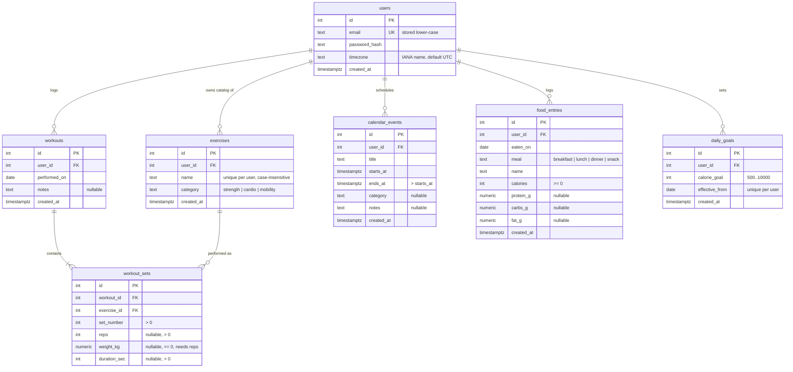

# Database schema

PostgreSQL 16. The schema is defined in two migrations under `server/migrations/`:

- `…_init-schema.sql`: tables, keys and constraints
- `…_query-indexes.sql`: the `(user_id, date)` indexes for the main query patterns (see [indexes.md](indexes.md))

## ER diagram

## Why each table exists

| Table             | Why it exists                                                                                                                                                                            |
| ----------------- | ---------------------------------------------------------------------------------------------------------------------------------------------------------------------------------------- |
| `users`           | Holds the login identity and the timezone that defines what "today" means for that user; every other row hangs off it.                                                                   |
| `exercises`       | A per-user catalog, so an exercise's name and category are stored once and every set points to it instead of repeating the name (which would let "Bench press" and "bench Press" drift). |
| `workouts`        | One training session on a date; it groups sets so a workout can be listed, edited or deleted as a unit.                                                                                  |
| `workout_sets`    | One set of one exercise inside a workout; it's a separate table because a workout has a variable number of sets (a repeating group, which 1NF says goes in its own table).               |
| `calendar_events` | A scheduled block of time; it stores absolute instants (`timestamptz`) because an event happens at a real moment, wherever the user is.                                                  |
| `food_entries`    | One thing eaten at one meal on one date; name and calories live on the entry because portions differ every time, so they describe this entry, not a shared "food".                       |
| `daily_goals`     | A history of calorie goals, so changing your goal today doesn't rewrite whether you hit your goal last month.                                                                            |

## Why each relationship exists (and what happens on delete)

| Relationship                 | Why                                                                                      | ON DELETE                                                                                                                                                                                                                                                                                                                             |
| ---------------------------- | ---------------------------------------------------------------------------------------- | ------------------------------------------------------------------------------------------------------------------------------------------------------------------------------------------------------------------------------------------------------------------------------------------------------------------------------------- |
| `users` → everything it owns | Every row belongs to exactly one user, which is what the API's ownership checks rely on. | `CASCADE`: deleting an account removes all of its data, leaving no orphans.                                                                                                                                                                                                                                                           |
| `workouts` → `workout_sets`  | A set only means something inside its workout.                                           | `CASCADE`: deleting a workout deletes its sets.                                                                                                                                                                                                                                                                                       |
| `exercises` → `workout_sets` | A set records which exercise was performed.                                              | `NO ACTION DEFERRABLE INITIALLY DEFERRED`: you can't delete an exercise that has history (the API returns 409). The check is deferred to COMMIT because deleting a user cascades along two paths (users→exercises and users→workouts→sets). An immediate check would run before the sets were gone and wrongly block the user delete. |

## Constraints worth knowing

- **Unique:** `users.email`; `exercises (user_id, lower(name))`, a unique _index_ because a constraint can't contain an expression; `workout_sets (workout_id, exercise_id, set_number)`; `daily_goals (user_id, effective_from)`.
- **CHECK:** non-blank text, `calories >= 0`, `reps > 0`, `ends_at > starts_at`, allowed values for category and meal, and a set must have `reps` or `duration_sec` (with `weight_kg` only alongside `reps`).
- **CHECK and NULL:** a CHECK only fails when its expression is _false_. `reps > 0` is _null_ when reps is NULL, so optional columns don't need `reps IS NULL OR ...`.
- **Not enforced by the database:** that a set's exercise belongs to the same user as its workout. A foreign key only proves the exercise exists. The API checks ownership inside the create-workout transaction (milestone 3). Enforcing it in the database would mean copying `user_id` onto `workout_sets`, which breaks 3NF because `workout_id` already determines `user_id`.
- **Not enforced by the database:** event overlap, because the API allows it when the client sends `allowOverlap=true`.

## Normalization (3NF) in one paragraph

Every non-key column depends on the key, the whole key, and nothing but the key. Sets are split out of workouts (no repeating groups → 1NF). Every table has a single-column surrogate key, so there are no partial dependencies (2NF). No non-key column determines another: a set stores `exercise_id`, not the exercise's name or category, and `workout_sets` deliberately has no `user_id`, because that is determined by `workout_id` (3NF).
